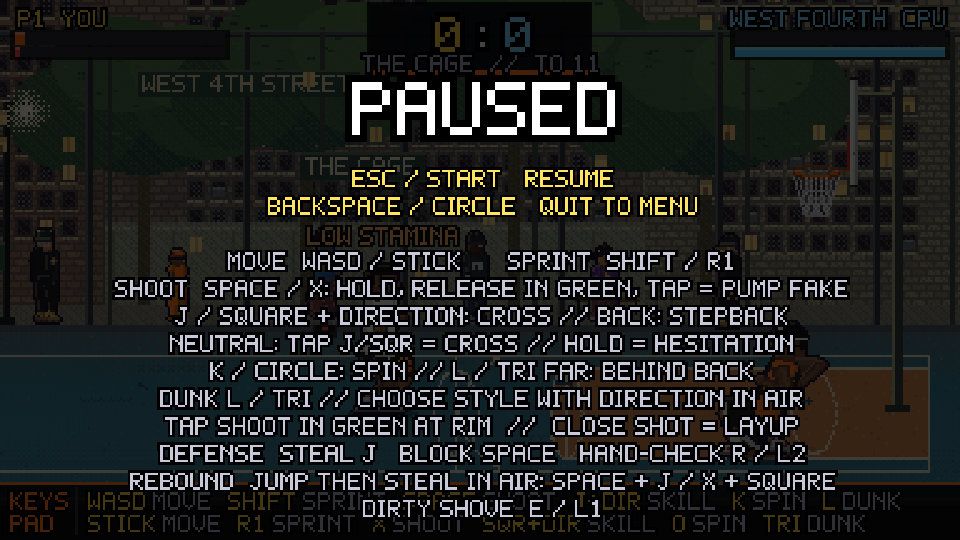

# Career, motion and court-depth pass

## MYPLAYER — a BALLOUT adaptation

The new main-menu MYPLAYER screen separates character development from win/loss rank. It is an original, compact adaptation of attributes/badges and promotion ladders, not the complete NBA 2K22 system or a copy of its formulas.

- Six attributes: shooting, finishing, handling, defense, speed and stamina. Start at 60, cap at 95. Spend the initial six points and earn three more per level. OVR is their rounded mean.
- XP: 50 per completed campaign game, 30 extra for a win, up to 70 for recorded makes/combos/steals. One level per 300 XP; cap level 40. Existing saves gain a fresh career without losing outfits, cash or court progress.
- Five badges: GREEN MACHINE (green window), RIM ARTIST (dunk and close-layup timing), QUICK CHAIN (move cost), PICK POCKET (steal chance), SECOND WIND (regen). Equip at most three. Bronze/Silver/Gold/Hall of Fame require both attribute thresholds 60/68/76/84 and performance milestones 3/12/30/60.
- Eighteen ranks in six colour groups: Rookie, Hooper, Baller, Ace, Master and Legend, each I–III. RP gains/losses depend on difficulty and rival tier relative to rank. A first loss at a demotion boundary has protection; a second consecutive loss can demote. Results show XP, level, OVR, RP and an UP/DOWN indicator when the rank changes.

These attributes, badge bonuses and ranks apply to the local AI campaign. Local/private PvP keeps equal base stats and awards no career XP/RP. This is not a server-verified global ranking or matchmaking service. Badge bonuses are modest and do not bypass full stamina-cost checks. Starter campaign physical stats match the previous defaults. The last MYPLAYER row resets attributes to 60 and refunds all spent points; XP, rank, performance milestones, equipped badges, inventory and currency remain. Badge tiers are recalculated from the reset attributes.

Concept references: [official 2K MyPLAYER attributes and badges](https://nba.2k.com/2k26/courtside-report/myplayer-builder/), [Bandai Namco promotion / rank-point design](https://www.bandainamcoent.com/news/tekken-8-patch-notes-v2-00). The implementation uses its own basketball attributes, badges, rank names and thresholds. The MYPLAYER screenshot uses a controlled demonstration profile.

## Dunk selection — implemented

After takeoff, while above 20 world units and before the final 0.03s leading into the slam, movement input above the 0.55 deadzone selects:

| Movement direction | Finish |
|---|---|
| Up / stick away from camera | Windmill |
| Down / stick toward camera | Two-hand |
| Forward relative to facing | One-hand |
| Back relative to facing | Reverse |
| Up → down while airborne | Double clutch |
| Back → up → forward while airborne | 360 slam |

Directional sequences require distinct turns at least 0.045 simulation seconds apart; holding a diagonal cannot complete one. A completed sequence locks its style until the slam. Neutral input retains the selection. The slam locks it. Direction does not reroll timing, shot odds or stamina cost, and does not change scoring. Both facings are tested. Combo heat bonuses remain tied to the combo, not to choosing a flashy animation.

## Skill moves — implemented

| Input with the ball | Action |
|---|---|
| J / Square + direction | Directional crossover |
| J / Square + backward relative to facing | Stepback |
| Neutral J / Square, release before 0.16 simulation seconds | Crossover |
| Neutral J / Square held for 0.16 simulation seconds | Hesitation; move the stick / WASD to burst out |
| K / Circle | Spin |
| L / Triangle away from dunk range | Behind the back |

Direction during the neutral gather immediately selects a cross or backward stepback. A held trick button starts only one move. Shooting, possession loss and other actions cancel the gather. The defender still uses J / Square for steals, so the new rules apply only with possession. Pause (Esc / Start) shows the controls.

Chain the next move within 0.68 simulation seconds. Input buffering permits the next move after 40% of the current animation. Examples: hesitation → cross → spin (HANG TIME), cross → stepback → cross (SNAKE BITE), behind the back → hesitation → cross (GHOST BURST). Every link pays the existing escalating stamina cost; badges only discount that cost. Zero stamina blocks moves and holding trick input prevents regeneration. Stationary hesitation never rolls ankle break; movement still faces the existing probabilistic spacing/defense check and cooldown. No combo guarantees a fall.

Each new move has a distinct body and dribble pose. Late movement input guides exits. A shot after stepback can cancel the late move and retains the backward fade penalty. Ordinary shot timing and near-rim dunk controls are unchanged. Keyboard and emulated standard gamepad input, both facings, held/released input, stamina and private guest-to-host input are covered by tests. Public Internet WebRTC is not covered by the substitute-transport test.

## Clothing, ball, rewards and scenery

Torso cloth now bends/shears between collar and hem using stride, lean, arm lift and secondary motion; the print shares that deformation. The chain is on the shirt but behind the near arm again. There are 32 additional baggy/wide/stacked denim, cargo and camo variants (eight camo palettes). Loose ankle folds overlay the shoe collar, preserving the toe/sole. Camo is mapped along the bent leg rather than screen coordinates. Item previews clear the new `bottomFit` field.

Ball diameter increases from 30 to 33 world units; the raster texture size is derived from the collision radius. A clean green money effect emits 30 bills instead of 12.

Added scenery sits behind the trees, based on these additional photo studies:

- The Cage: village apartment masonry and handball-wall context — [photo](https://www.bridgeandtunnelclub.com/bigmap/manhattan/villages/greenwich/west4thstreetcourts/0810-07-09.jpg).
- Rucker: the dominant tall brick apartment slab — [Under Armour renovation photo](https://about.underarmour.com/content/ua/about/en/stories/2021/10/stephen-curry---anybody-who-knows-harlem-knows-what-it-means-to-/_jcr_content/root/container/container/multiimage/images/images2_5619758.uaimg.jpg).
- Dyckman: apartment blocks and lower infill behind the canopy — [Monsignor Kett landscape architect gallery](https://www.jonernsberger.com/monsignor-kett-park/). The existing selected green tournament-era floor is retained.
- Mosswood: lower residential roofs, shrubs and a distant taller building, preserving the open park setting — [photo](https://imagescdn.homes.com/i2/MSUb_P0M_igSo-FB8Ipeysuats8TlJILOf-T9Ucpj1c/117/mosswood-oakland-ca.jpg?p=1).

## Verification

Pure tests cover XP/OVR/attribute caps, badge tiers/slots, rank changes and demotion protection, old saves, four airborne dunk choices in both facings, deadzone/lock and unchanged stamina cost. Existing tests cover action costs, progression, wardrobe, faces, falls, rim rewards, ambient and networking. Chromium exercises menu navigation, upgrades, badge equip, live campaign effects, airborne keyboard choice, match XP, reload persistence, court rendering and private PvP with equal base stats. The two-browser online test uses a substitute transport; Internet WebRTC remains outside that test.

All peers must use `ballout-private-8` because held skill input, move kinds, ball radius and dunk-direction rules changed. Replay input format is now 2 (held skill bit 1024).
