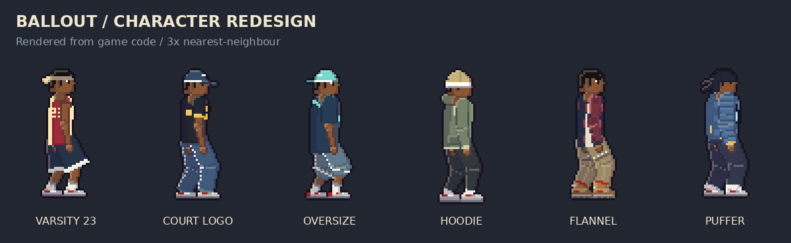
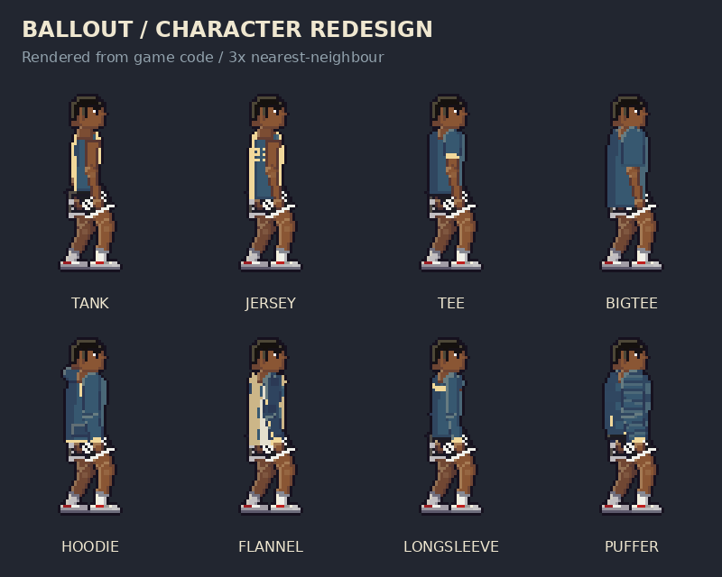
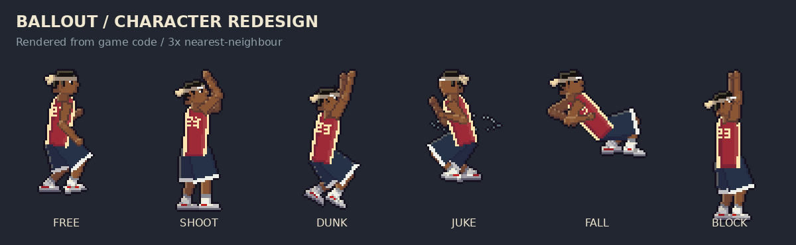
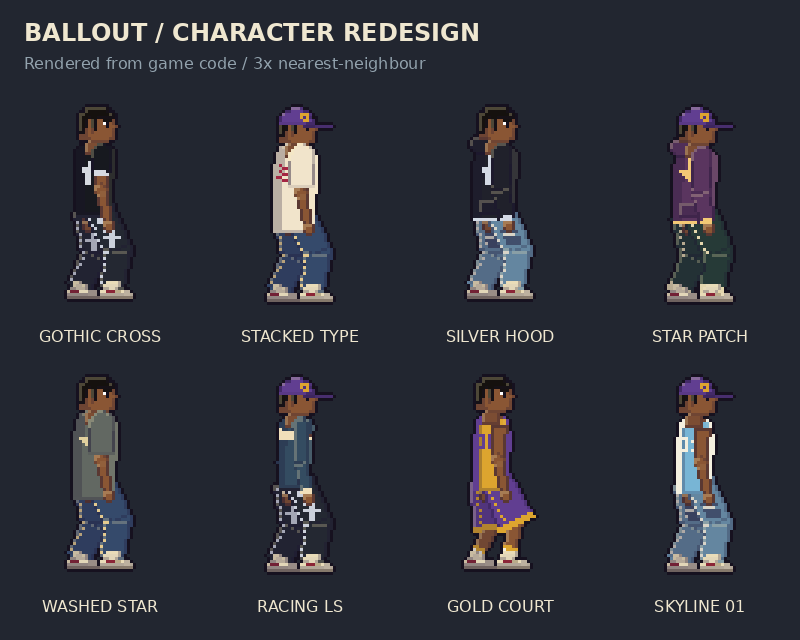
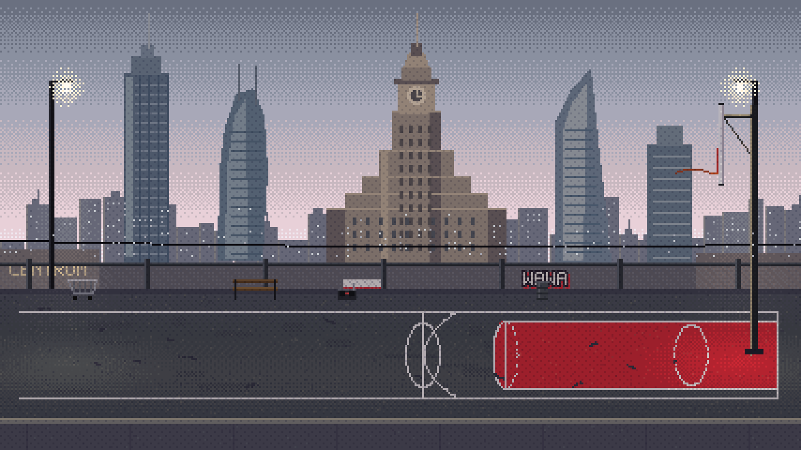
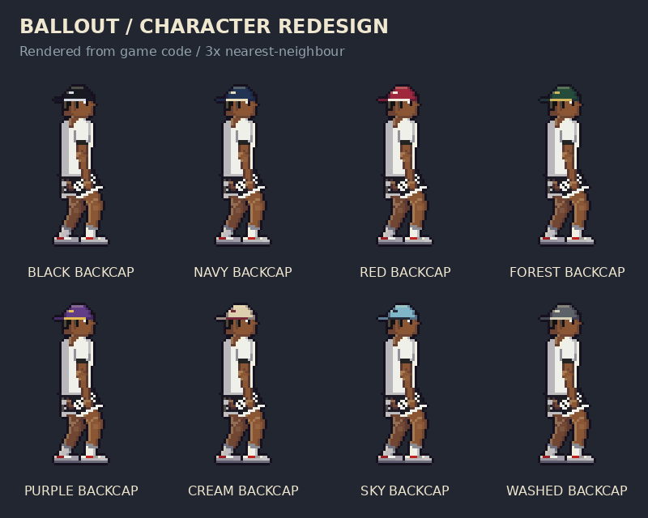

# Character redesign

This redesign and its follow-up fixes are isolated on `codex/character-redesign`, based on the merged court/gameplay/SFX improvements. Existing shop prices and saved item IDs are preserved. Follow-up takeoff rules are documented below.

## Adding a recognizable item

`src/wardrobe.ts` owns the eight garment silhouettes in art pixels: hem length, waist/chest/shoulder widths, sleeves, cuffs and neckline. The renderer adds tank piping, jersey mesh-style trim, dropped oversize sleeves, a hoodie pocket/drawstrings, open checked flannel and padded jacket panels. Pants have separate fits and cargo pockets; footwear has different soles, toe panels, laces and boot tread.

`Loadout.topGraphic` is optional: `none`, `number`, `box`, `diagonal` or `stripe`. `jerseyNumber` accepts 0–99. Set these in the catalog item's `patch`, alongside `topColor` and `topTrim`. Build loadouts through `buildLoadout` so item-specific details reset when changing tops. Old equipment saves remain valid; no migration is required.

Three purchasable examples are included: COURT LOGO TEE, VARSITY 23 and DIAGONAL OVERSIZE. Existing items keep their IDs. The showcase uses existing accessories to demonstrate complete outfits; it does not add free inventory or unlock shop items.

## Validation and previews

- `npm run build`
- `node scripts/check-gameplay.cjs`
- `SPRITE_QA=1 node scripts/check-wardrobe.cjs`
- `python scripts/render-wardrobe.py` (Pillow; regenerates these three sheets)

The wardrobe check compares silhouettes in the same colors, renders 288 poses across actions and both facings, checks texture borders, and exercises top purchases and print reset. Sheets are actual CPU-rendered game sprites, enlarged without smoothing. Full browser playtesting remains necessary to assess motion and performance in a match.

## Clothing seam fixes and streetwear expansion

The hip bridge now covers the gap between the trouser legs, the waistband stays at hip level, and the bare torso no longer extends below it. Fabric joint patches close the outer knee and elbow wedges when limbs bend. Sleeve starts and shoulder widths have been adjusted to remove the projecting shoulder blocks.

16 additional store items include gothic-cross tees/hoodies, star patches, stacked graphics, racing stripes, two numbered basketball jerseys, a cream puffer, flap-stitch/cross-patch/distressed denim, track sweats, varsity shorts, a fitted cap and cream high-tops. The designs use original graphics inspired by basketball and rap streetwear.

`topGraphic` additionally supports `cross`, `stars`, and `stacked`. Optional `bottomDetail` supports `stitched`, `crosses`, `ripped`, and `stripe`. Both remain item-level options, so equipping a plain item clears the details. Distressed denim uses dark backing and light fraying rather than accidental exposed joints.

Regression checks additionally inspect covered knees, elbows and the hip area for skin leakage. The showcase generator now produces four sheets.

## Warsaw Centrum court

Warsaw is now labeled CENTRUM, including the region's city label. The low street frontage leaves the Palace of Culture's stepped wings, clock and spire visible, with stylized Varso, Warsaw Spire and Zlota 44 silhouettes beside it. Keeps the existing overcast pixel palette, court surface, hoop, spectator positions and tram animation. The tram now runs below the skyline; the parked car is removed.

This is the static scenery preview; the in-game crowd, moving tram and animated net are separate layers. `node scripts/render-warsaw.cjs` exports the three actual 427x240 static RGBA layers to `/tmp` for inspection.

## Headwear and dunk availability

Eight new backward caps are in the store. Afro/hi-top hair uses a tucked rendering under fullcap, backcap, fitted cap, beanie, bucket and durag. This never changes the equipped hairstyle or save; removing the hat restores the original hair. Headbands retain the full hairstyle.

`Hooper.canDunk` is shared by controls, AI and the DUNK READY hint. Takeoff requires possession, a free/juke grounded state, at least 10 stamina, the ball cleared when necessary, and a close central position (190 world-unit weighted radius, lane offset at most 50). There is no minimum running speed. Active defenders within 34 depth units of the approach lane prevent takeoff until the attacker has a clear 24-unit lead; falling, staggered or recovering defenders count as beaten. A defender outside the approach lane does not block takeoff. Starting with L/V or Triangle shows the existing timing meter. A defender may still attempt a block after takeoff.

The tests cover standing takeoff, distance/lane/stamina limits, passing versus an active guard, an off-lane defender, a jumping guard, grounded defenders, clearance and invalid player states. Headwear tests compare tucked afro/hi-top renders to short hair and verify that the equipped hairstyle is not mutated.

## Follow-up: seams, progression, contests and rebounds

The torso is narrower in profile, the shoulder contour tapers, and each arm attaches at an appropriate side offset. Trouser legs and skin no longer have rounded hip caps pushing through the shirt; the pelvis bridge now matches the current garment width. Neckline skin is drawn only where exposed. Chains follow the narrower torso. Store previews clear the previous top/bottom's optional graphics before applying another item's patch.

All courts have six ordered rivals with strictly increasing stats. Only a victory over an unlocked selected rival advances progression; losses, PvP and replays cannot skip locked opponents. Save migration keeps existing equipment/currency. Global AI difficulty remains separate from tier. The menu shows the unlocked count and next locked rival.

AI shot defense now preserves a jump tap even without held shoot input. Each shot gets one contest decision with a reaction delay and a later takeoff window. Active rebounds use jump then steal in the air, for both player and CPU; nearby ground balls retain proximity pickup. The UI shows rebound controls when the ball is airborne/loose.

Acceleration/braking and direction reversals are sharper, while top speed remains unchanged. The fixed simulation remains 240 Hz; action buffer is 90 ms. Local PvP stats are equal for both players. This is movement tuning, not a networked ranked implementation.

Independent Chiraq/Warsaw BGM folders are scanned automatically in CI. SFX now use nine trimmed CC0 recording variants with no oscillator fallback; see public/audio/sfx/CREDITS.md. Backboard/dunk accents reuse softened rim recordings. Audio is gesture-unlocked, decoded once and pooled in Web Audio.

New checks cover old-save migration, ordered ladders on all 11 maps, actual win/loss advancement, global/tier separation, AI jump taps, active/ground rebounds, prompt reversal/braking, store-preview detail reset and valid unclipped PCM audio files. Full match playtesting and listening in the target browser remain necessary for final feel/mix balancing.
